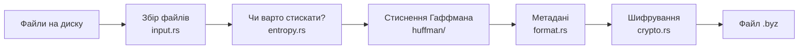
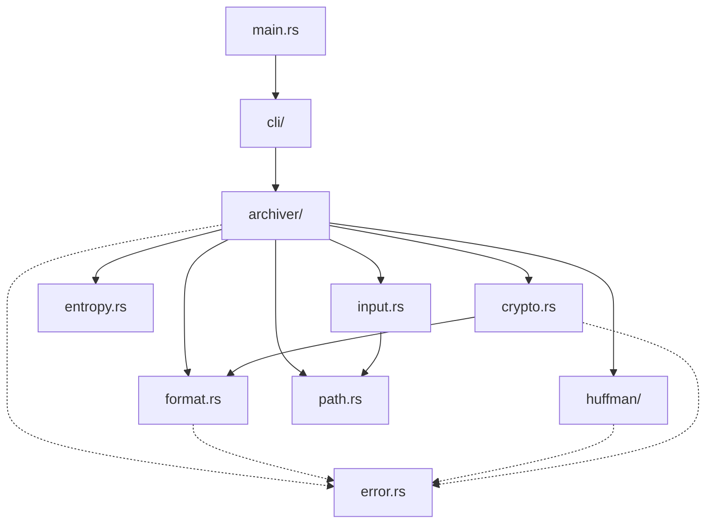

# Путівник по коду bychkov-zip

Цей документ для тих, хто відкриває проєкт уперше. Тут пояснено, **як
влаштований код усередині**: що робить кожен файл, як дані проходять через
програму і в якому порядку краще читати код. Як користуватися програмою —
дивіться в [`README.md`](README.md), а побайтовий опис формату —
у [`docs/FORMAT.md`](docs/FORMAT.md).

---

## 1. Що це за програма, коротко

`byz` — консольний архіватор, написаний на Rust. Він уміє дві речі:

- **`byz create`** — бере файли й папки, стискає їх, шифрує паролем і
  зберігає в один файл `.byz`;
- **`byz extract`** — розшифровує файл `.byz` і відновлює з нього файли.

Усе, що він робить, можна уявити як конвеєр:



Розпакування — той самий конвеєр, тільки у зворотний бік, і з
перевірками на кожному кроці.

---

## 2. Дві половини: бібліотека і CLI

Крейт `core/` складається з двох частин:

| Частина | Вхідний файл | Що робить |
|---|---|---|
| **Бібліотека** `bychkov_zip` | [`core/src/lib.rs`](core/src/lib.rs) | Уся «справжня» робота: стиснення, шифрування, формат, розпакування. Нічого не друкує на екран. |
| **Програма** `byz` | [`core/src/main.rs`](core/src/main.rs) | Тонка обгортка: розбирає аргументи, питає пароль, друкує прогрес і помилки. |

Чому так розділено: бібліотеку можна викликати з тестів або з майбутнього GUI
(`gui/`), не тягнучи за собою термінал. CLI просто «підключається» до неї.

---

## 3. Карта файлів

```text
core/src/
├── main.rs           ← старт програми byz
├── lib.rs            ← список модулів бібліотеки
│
├── cli/              ← ВСЕ, що стосується термінала
│   ├── args.rs       ← які команди й прапорці є (create / extract)
│   ├── commands.rs   ← що робить кожна команда
│   ├── password.rs   ← як прочитати пароль
│   └── reporter.rs   ← друк прогресу в stdout
│
├── archiver/         ← «диригент»: викликає інші модулі в правильному порядку
│   ├── mod.rs        ← спільні константи, етапи, події прогресу
│   ├── create.rs     ← створення архіву
│   ├── extract.rs    ← розпакування архіву
│   └── tests.rs      ← тести архіватора
│
├── input.rs          ← обхід файлів і папок, які передав користувач
├── path.rs           ← перевірка, що шлях безпечний
├── entropy.rs        ← оцінка, чи стиснеться файл
├── huffman/          ← алгоритм стиснення Гаффмана
├── format.rs         ← як байти лежать у файлі .byz
├── crypto.rs         ← пароль → ключ, шифрування AES-GCM
└── error.rs          ← усі можливі помилки і коди виходу
```

---

## 4. Що відбувається під час `byz create`

Наприклад, користувач запускає:

```sh
byz create backup.byz docs notes.txt
```

Крок за кроком:

1. **[`main.rs`](core/src/main.rs)** викликає `cli::args::parse()` — бібліотека
   `clap` перетворює рядок аргументів у структуру
   `Command::Create { output, inputs, force }`.
2. **[`cli/commands.rs`](core/src/cli/commands.rs)** перевіряє, чи не існує вже
   `backup.byz` (якщо існує і немає `--force` — помилка), і просить пароль.
3. **[`cli/password.rs`](core/src/cli/password.rs)** читає пароль: у терміналі —
   приховано і двічі, у скрипті — один рядок зі `stdin`.
4. Далі викликається бібліотечна функція `create_archive` з
   **[`archiver/create.rs`](core/src/archiver/create.rs)**. Вона:
   1. через **[`input.rs`](core/src/input.rs)** збирає список усіх файлів
      (папки обходяться рекурсивно, відкидаються дублікати й symlink-и,
      рахується загальний розмір — не більше 500 МіБ);
   2. для кожного файлу викликає `pack_file`:
      - **[`entropy.rs`](core/src/entropy.rs)** дивиться, чи схожі дані на
        випадкові (вже стиснені, зашифровані). Якщо так — не стискаємо;
      - інакше **[`huffman/`](core/src/huffman/mod.rs)** стискає файл;
      - якщо після стиснення вийшло не менше, ніж було, файл зберігається як є
        (`STORED`);
   3. **[`format.rs`](core/src/format.rs)** записує метадані: список файлів,
      їхні шляхи, розміри й прапорець «стиснутий чи ні»;
   4. функція `seal` через **[`crypto.rs`](core/src/crypto.rs)** генерує
      випадкову сіль і nonce, робить із пароля ключ (Argon2id) і шифрує все
      (AES-256-GCM);
   5. результат пишеться спершу у `backup.byz.tmp`, а потім перейменовується в
      `backup.byz` — щоб у разі збою не лишився наполовину записаний архів.
5. Протягом усього процесу архіватор викликає `on_event(...)`, а
   **[`cli/reporter.rs`](core/src/cli/reporter.rs)** друкує це як
   `byz-status:compressing`, `byz-progress:42` тощо.

---

## 5. Що відбувається під час `byz extract`

```sh
byz extract backup.byz -o restored
```

Головна ідея розпакування: **спочатку перевірити все, і лише потім писати на
диск**. Якщо пароль неправильний або архів зіпсований, на диску не з'явиться
жодного файлу.

Функція `extract_archive` у
**[`archiver/extract.rs`](core/src/archiver/extract.rs)**:

1. перевіряє розмір файлу ще до читання (захист від гігантських файлів);
2. читає заголовок (`format.rs`): правильні «магічні» байти `BYZ\x01` і
   версія `1`? Якщо ні — `BAD_FORMAT`;
3. робить ключ із пароля і розшифровує (`crypto.rs`). Неправильний пароль або
   будь-яка зміна байтів → `AUTH_FAILED`;
4. розбирає метадані й перевіряє, що розміри сходяться і сума розпакованого
   не більша за 500 МіБ (захист від «zip-бомби»);
5. перевіряє кожен шлях через **[`path.rs`](core/src/path.rs)** — щоб архів не
   міг записати щось типу `../../Windows/evil.exe`;
6. розпаковує всі файли **в пам'ять** (Гаффман або як є);
7. перевіряє, що жоден цільовий файл ще не існує (нічого не перезаписуємо);
8. і тільки тепер записує файли на диск, ще раз перевіряючи, що кожна папка
   справді лежить усередині вихідної теки.

---

## 6. Модулі детальніше

### `error.rs` — помилки

Один тип `ByzError` на весь проєкт. Кожен варіант має свій код виходу
(`exit_code`) і текстову назву (`code_name`), наприклад `AuthFailed` → `3`,
`"AUTH_FAILED"`. Також тут оголошено скорочення
`Result<T>` = `Result<T, ByzError>`, тому в коді майже всюди пишуть просто
`Result<...>`. Оператор `?` передає помилку вгору аж до `main.rs`, який друкує
`byz-error:<CODE>:<повідомлення>` і завершує програму з відповідним кодом.

### `input.rs` — збір файлів

Структура `Collector` проходить по всіх шляхах, які дав користувач:

- файл → додається під своїм іменем;
- папка → обходиться (без рекурсії, через власний стек), і кожен файл
  отримує шлях вигляду `папка/підпапка/файл.txt`;
- symlink усередині папки → пропускається, а переданий напряму → помилка;
- перевіряє дублікати без урахування регістру (`A.txt` і `a.txt` — конфлікт,
  бо на Windows це один і той самий файл), а також конфлікт «файл і папка з
  однаковим ім'ям».

### `path.rs` — безпечні шляхи

Функція `validate_archive_path` відкидає все небезпечне: абсолютні шляхи,
`..`, порожні частини (`a//b`), символи `\` і `:`, керуючі символи, імена з
крапкою чи пробілом у кінці та зарезервовані імена Windows (`CON`, `NUL`,
`COM1`…). Використовується і під час створення, і під час розпакування.

### `entropy.rs` — чи варто стискати

Рахує **ентропію Шеннона** — число від 0 до 8, яке показує, наскільки
«хаотичні» байти:

- близько 0 — дані дуже одноманітні, стискаються чудово;
- близько 8 — дані схожі на випадкові (JPEG, ZIP, зашифроване), стиснути
  неможливо.

Якщо ентропія ≥ 7.5, архіватор навіть не намагається стискати файл.

### `huffman/` — стиснення

Ідея Гаффмана: байти, що трапляються часто, кодуються короткими бітовими
кодами, а рідкісні — довгими. Модуль розбитий на кроки:

| Файл | Що робить |
|---|---|
| [`lengths.rs`](core/src/huffman/lengths.rs) | рахує, скільки разів трапився кожен байт, будує дерево Гаффмана і визначає **довжину коду** кожного байта |
| [`canonical.rs`](core/src/huffman/canonical.rs) | за самими лише довжинами будує **канонічні коди** — однозначні, тому в архіві достатньо зберегти 256 довжин, а не все дерево |
| [`bitio.rs`](core/src/huffman/bitio.rs) | `BitWriter` / `BitReader` — запис і читання окремих бітів |
| [`decoder.rs`](core/src/huffman/decoder.rs) | відновлює байти з потоку бітів, не будуючи дерева |
| [`mod.rs`](core/src/huffman/mod.rs) | дві публічні функції: `compress` і `decompress` |

Стиснутий блок виглядає так: `[256 байт таблиці довжин][біти]`. Через ці 256
байт маленькі файли стискати невигідно — тому і є перевірка «стало менше чи
ні».

### `format.rs` — структура файлу `.byz`

Цей модуль нічого не стискає й не шифрує — він тільки знає, **де які байти
лежать**:

```text
┌──────────────── 33 байти, відкрито ────────────────┐┌──── зашифровано ────┐
│ MAGIC "BYZ\x01" │ VERSION=1 │ SALT 16 б │ NONCE 12 б ││ метадані │ файли │TAG│
└────────────────────────────────────────────────────┘└─────────────────────┘
```

- `Header` — відкритий заголовок (`to_bytes` / `from_bytes`);
- `FileEntry` — один запис у метаданих: шлях, початковий розмір, розмір в
  архіві, прапорці;
- `Metadata` — список усіх `FileEntry`;
- `Reader` — допоміжний «курсор», який безпечно читає числа з байтів і не дає
  вийти за межі масиву.

Під час читання модуль ретельно перевіряє, що дані «схожі на правду», бо
архів може бути підробленим.

### `crypto.rs` — шифрування

- **Argon2id** перетворює пароль + випадкову сіль на 256-бітний ключ. Він
  навмисно повільний і використовує 64 МіБ пам'яті, щоб підбір паролів був
  дорогим.
- **AES-256-GCM** шифрує дані й додає 16-байтний **тег** — своєрідний
  «підпис». Якщо змінити хоч один байт архіву або ввести неправильний пароль,
  тег не зійдеться і буде помилка `AUTH_FAILED`, а не сміття замість даних.
- Відкритий заголовок передається в шифр як **AAD** (додаткові дані): він не
  шифрується, але теж захищений тегом — підмінити сіль чи версію не вийде.
- Ключ і пароль зберігаються в обгортці `Zeroizing`, яка затирає їх у
  пам'яті після використання.

### `archiver/` — диригент

Сам нічого не рахує, лише викликає інші модулі в правильному порядку (див.
розділи 4 і 5). У [`mod.rs`](core/src/archiver/mod.rs) є:

- ліміти `MAX_INPUT_BYTES` (500 МіБ) і `MAX_ARCHIVE_BYTES`;
- `Stage` — етапи (`Analyzing`, `Compressing`, `Encrypting`, …);
- `Event` — подія для того, хто стежить за процесом: статус або відсоток.

Архіватор **нічого не друкує сам** — він викликає передану йому функцію
`on_event`. CLI друкує ці події в `stdout`, а тести просто збирають їх у
список і перевіряють.

### `cli/` — термінал

| Файл | Що робить |
|---|---|
| [`args.rs`](core/src/cli/args.rs) | опис команд через `clap` (аліаси `c` і `x`, прапорці `--force`, `-o`) |
| [`commands.rs`](core/src/cli/commands.rs) | з'єднує аргументи, пароль і бібліотечні функції |
| [`password.rs`](core/src/cli/password.rs) | читає пароль із термінала або зі `stdin` |
| [`reporter.rs`](core/src/cli/reporter.rs) | перетворює `Event` у рядки `byz-status:` / `byz-progress:` |

---

## 7. Як модулі залежать один від одного



Правило просте: стрілки йдуть **тільки вниз**. Низькорівневі модулі
(`huffman`, `entropy`, `crypto`) нічого не знають про архіватор і CLI, тому їх
легко тестувати окремо.

---

## 8. Тести

- **Модульні тести** лежать у кінці кожного файлу в блоці
  `#[cfg(test)] mod tests { ... }`. Наприклад, у `huffman/mod.rs` перевіряється,
  що «стиснули → розпакували → отримали те саме».
- **Тести архіватора** — у [`archiver/tests.rs`](core/src/archiver/tests.rs):
  неправильний пароль, зіпсований архів, небезпечні шляхи, ліміти тощо.
- **Наскрізні тести** — у [`core/tests/cli.rs`](core/tests/cli.rs): запускають
  справжній бінарник `byz` і перевіряють його вивід і коди виходу.
- **CI** ([`.github/workflows/ci.yml`](.github/workflows/ci.yml)) на кожен push і
  pull request запускає `cargo fmt --check`, `cargo clippy` і `cargo test`.

Запуск усіх тестів:

```sh
cd core
cargo test --all-targets
```

Запуск тестів лише одного модуля, наприклад Гаффмана:

```sh
cargo test huffman
```

---

## 9. З чого почати читати код

Рекомендований порядок — від простого до складного:

1. [`error.rs`](core/src/error.rs) — коротко і дає словник помилок.
2. [`main.rs`](core/src/main.rs) → [`cli/commands.rs`](core/src/cli/commands.rs) —
   звідки все починається.
3. [`archiver/create.rs`](core/src/archiver/create.rs) — головний сценарій
   створення архіву; далі заходьте у функції, які він викликає.
4. [`entropy.rs`](core/src/entropy.rs) — маленький модуль з однією формулою.
5. [`format.rs`](core/src/format.rs) разом із [`docs/FORMAT.md`](docs/FORMAT.md).
6. [`archiver/extract.rs`](core/src/archiver/extract.rs) — подивіться, скільки
   там перевірок і чому вони йдуть саме в такому порядку.
7. [`huffman/`](core/src/huffman/mod.rs) і [`crypto.rs`](core/src/crypto.rs) —
   найбільш «алгоритмічні» частини, їх краще залишити наостанок.

---

## 10. Невеликий словник

| Термін | Пояснення |
|---|---|
| **крейт** (crate) | пакет Rust; у нас це `core/` |
| **модуль** | файл або папка з кодом усередині крейта |
| `Result<T>` | або `Ok(значення)`, або `Err(помилка)` |
| `?` | «якщо тут помилка — одразу поверни її вгору» |
| **STORED** | файл збережений без стиснення |
| **ентропія** | міра «випадковості» даних, 0–8 біт на байт |
| **сіль (salt)** | випадкові байти, які додаються до пароля, щоб однакові паролі давали різні ключі |
| **nonce** | одноразове випадкове число для шифру |
| **тег GCM** | 16 байт у кінці архіву, які доводять, що дані не змінювали |
| **AAD** | дані, які не шифруються, але захищені від підміни (у нас — заголовок) |
| **round-trip** | тест «закодували → розкодували → отримали те саме» |

---

## 11. Що далі

Нові алгоритми (LZ77, пакування томів, CRC32, MLP, генетичний алгоритм)
поки що **не реалізовані** — це завдання для команди в [`TASKS.md`](TASKS.md).
Правила роботи над ними — в [`AGENTS.md`](AGENTS.md). Формат `.byz` версії 1
заморожений: будь-яка зміна розкладки байтів потребує нової версії формату.
